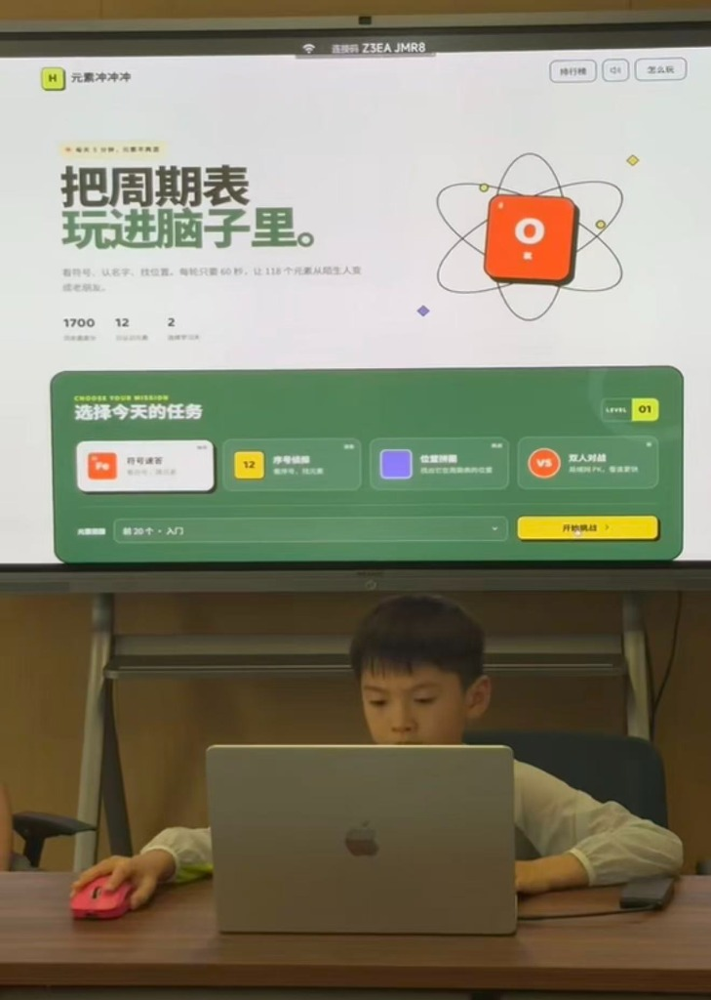

# 元素冲冲冲 · Element Rush

[中文](#-中文介绍) | [English](#-english-version)

> **你有多久没有想起过化学元素周期表？你还记得吗？**  
> *When was the last time you thought about the Periodic Table? Do you still remember it?*

  
   
  <em>小学三年级的小朋友在现场展示与体验由自己构思设计的《元素冲冲冲》</em>

---

## 🇨🇳 中文介绍

我在这里分享《元素冲冲冲》：一个由**开学三年级的小朋友**提出想法、设计玩法，并在 AI 结对编程协作下完成的化学元素周期表记忆游戏。

它把原本枯燥的“死记硬背元素周期表”变成了趣味十足的短回合闯关：**看符号、认名字、找位置**，在轻松的游戏过程中让 118 个化学元素从陌生人变成老朋友。

### 🎮 在线体验

- 🌟 **在线体验 / GitHub Pages**：[https://zhenfangzhu.github.io/element-rush/](https://zhenfangzhu.github.io/element-rush/)
- 💻 **本地单人体验**：直接在浏览器中打开 `index.html`
- 🌐 **局域网双人对战**：在项目目录运行 `npm start` 后访问 [http://localhost:8000](http://localhost:8000)。

### 🕹️ 玩法特色

- **🧪 符号速答**：看到元素符号，快速选出正确名称与拼音
- **🔢 序号侦探**：根据原子序数寻找对应的化学元素
- **🧩 位置拼图**：在周期表中定位元素所在的周期与族
- **👥 双人对战**：两台同一局域网内的设备使用房间号即时 PK
- **🗺️ 探索地图**：答对的元素会在 118 周期表探索地图上永久点亮
- **🏆 全网打榜**：三大挑战模式独立排行榜（Supabase 云端实时同步，支持前 100 名最快速度、正确率与高分角逐）
- **📈 本地记录**：学习天数、最高分和已认识元素自动保存在本地

### 👦 小创作者（Creator）

- **创意与设计**：一名开学小学三年级的小朋友
- **创作初衷**：觉得死记硬背周期表太无聊，希望做成一个好玩、能跟同学比速度的闯关游戏。
- **开发过程**：小朋友提出完整玩法规则与交互构想，与 AI 结对编程独立协作完成。

### 💡 为什么开源

我希望通过这个项目记录一件真实发生的小事：**一个孩子有了想法，可以和 AI 一起把它做成可以被别人使用的软件。**

如果它也让你重新想起元素周期表，或者让另一个孩子开始动手创造，我会觉得这份分享很有意义。

---

## 🌍 English Version

I share **Element Rush** here: an interactive Periodic Table learning and speed-challenge web game conceived and designed by **a 3rd grade elementary school student** and built in collaboration with AI pair programming.

It transforms tedious chemistry memorization into exciting, bite-sized 60-second challenges: **recognizing atomic symbols, identifying atomic numbers, and pinpointing positions on the periodic table**.

### 🎮 Live Demo

- 🌟 **Live demo / GitHub Pages**: [https://zhenfangzhu.github.io/element-rush/](https://zhenfangzhu.github.io/element-rush/)
- 💻 **Local Play**: Simply open `index.html` in any web browser.
- 🌐 **LAN Multiplayer**: Run `npm start` in the project directory and visit `http://localhost:8000`.

### ✨ Game Features

- **🧪 Symbol Rush**: See the chemical symbol (e.g. `Fe`), identify the element name & pinyin.
- **🔢 Atomic Detective**: Look at the atomic number (e.g. `26`), find the corresponding element.
- **🧩 Periodic Grid**: Pinpoint the exact period & group position on the periodic table.
- **👥 Local Duo Battle**: Real-time 1v1 multiplayer over local Wi-Fi with room codes.
- **🗺️ Interactive Map**: Light up all 118 elements on the periodic table as you answer correctly.
- **🏆 Global Leaderboard**: Real-time cloud rankings powered by Supabase (supporting Top 100 fastest times, accuracy, and high scores across all 3 modes).
- **📱 Responsive Neo-Brutalist UI**: Beautifully optimized for mobile touchscreens and desktop screens alike.

### 👦 The Young Creator

- **Creator & Game Designer**: A 3rd Grade Elementary Student
- **Inspiration**: Wanted to make memorizing chemistry fun and engaging so kids and students can race with classmates instead of memorizing dry charts.
- **How it was built**: The student conceived the rules, visual layout, and game flow, pairing with AI to write and refine the production-ready code.

### 💡 Why Open Source?

Through this project, I want to document something that happened: **a child with an idea empowered by AI to build software that anyone around the world can play.**

If this inspires you to revisit chemistry, or sparks another child's curiosity to start creating, I will consider it well worth sharing.

---

## 🔒 Privacy & License

- **Privacy**: No tracking or private data collection. Offline progress is saved in local browser storage; cloud leaderboards only record custom player nicknames and scores.
- **License**: Released under the [MIT License](LICENSE). Free to use, learn, and modify!

## 反馈 / Feedback

如果你遇到问题或有玩法建议，欢迎在 [Issues](https://github.com/zhenfangzhu/element-rush/issues) 中告诉我，并提供复现步骤、浏览器及设备信息。

If you find a bug or have a gameplay suggestion, please let me know by opening an issue with reproduction steps and your browser and device details.
